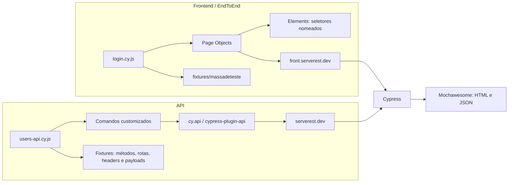

# 🧪 ServeRest QA Automation

> Suíte de testes automatizados para validar os principais fluxos da interface Web e da API ServeRest, usando Cypress e JavaScript.


## 🎯 Objetivo

- Validar fluxos críticos do frontend em [front.serverest.dev](https://front.serverest.dev/).
- Testar endpoints da API em [serverest.dev](https://serverest.dev/).
- Separar responsabilidades entre cenários, Page Objects, elementos de interface e massas de teste.
- Gerar relatórios de execução com Mochawesome.

## 🗂️ Estrutura do projeto

```text
serverest-automation-suite/
├── .github/
│   └── workflows/
│       ├── api-tests.yml             # Pipeline de testes de API e upload do relatório
│       ├── cypress.yml               # Executa os testes de API e Web
│       └── test-report.yml            # Executa a suíte e gera/publica o relatório
├── cypress/
│   ├── Elements/                      # Seletores nomeados da interface
│   │   ├── LoginElements.js
│   │   └── RegisterElements.js
│   ├── config/
│   │   └── environments.js            # Mapa de URLs de ambientes
│   ├── e2e/
│   │   ├── Api/
│   │   │   └── users-api.cy.js         # Cenários automatizados da API
│   │   └── EndToEnd/
│   │       └── login.cy.js             # Cenários automatizados do frontend
│   ├── fixtures/
│   │   ├── api/
│   │   │   └── common/
│   │   │       ├── endpoints.js        # Rotas da API
│   │   │       ├── headers.js          # Headers HTTP reutilizáveis
│   │   │       └── methodRest.js       # Verbos HTTP
│   │   ├── massadeteste/
│   │   │   └── web-test-data.json      # Massas dos cenários Web
│   │   └── payload/
│   │       ├── return/                 # Respostas esperadas da API
│   │       │   ├── create-user-response.json
│   │       │   ├── login-response.json
│   │       │   ├── return_body_post_200.json
│   │       │   └── users-response.json
│   │       └── send/                   # Payloads enviados para a API
│   │           └── user-api-bodies.json
│   ├── pageObject/                     # Ações e fluxos das páginas Web
│   │   ├── LoginPage.js
│   │   └── RegisterPage.js
│   ├── reports/                        # Relatórios gerados pelo Cypress/Mochawesome
│   ├── screenshots/                    # Evidências de falhas, quando geradas
│   └── support/
│       ├── commands.js                 # Comandos customizados, incluindo cy.apiRequest
│       └── e2e.js                      # Inicialização do suporte Cypress
├── clean-reports.js                    # Limpeza de relatórios anteriores
├── cypress.config.js                   # Configuração do Cypress e URLs base
├── package.json                        # Dependências e scripts npm
├── package-lock.json                   # Versões travadas das dependências
├── run-and-report.js                   # Execução e geração de relatório
└── README.md
```

## 🧭 Arquitetura dos testes



## 🧩 Organização e responsabilidades

### 🌐 Testes Web

Os cenários estão em `cypress/e2e/EndToEnd/`. Eles descrevem o comportamento esperado e chamam métodos dos Page Objects, sem manter seletores ou massas diretamente no spec.

- `cypress/pageObject/`: ações e fluxos, como preencher login, enviar formulário e navegar.
- `cypress/Elements/`: seletores centralizados e nomeados, como `emailInput`, `submitButton` e `adminCheckbox`.
- `cypress/fixtures/massadeteste/`: credenciais e dados usados pelos cenários Web.

### 🔌 Testes de API

Os cenários estão em `cypress/e2e/Api/` e usam `cy.api` por meio do plugin `cypress-plugin-api`.

- `cypress/support/commands.js`: oferece comandos reutilizáveis como `cy.apiRequest()` e `cy.apiLogin()`.
- `cypress/fixtures/api/common/`: centraliza endpoints, headers e métodos HTTP.
- `cypress/fixtures/payload/send/`: armazena dados enviados nas requisições.
- `cypress/fixtures/payload/return/`: armazena valores e tipos esperados nas respostas.

### 📊 Relatórios e evidências

O Cypress e o Mochawesome escrevem relatórios HTML/JSON em `cypress/reports/`. A pasta `cypress/screenshots/` recebe capturas quando configuradas/geradas em execuções com falha. `clean-reports.js` remove arquivos HTML e JSON antigos antes das execuções definidas nos scripts.

## ✅ Cenários cobertos

### API

1. Login com credenciais válidas.
2. Listagem de usuários.
3. Cadastro de usuário com payload válido.
4. Rejeição de login com credenciais inválidas.
5. Rejeição de cadastro com campos obrigatórios vazios.

### Frontend

1. Login com sucesso.
2. Mensagem de erro para credenciais inválidas.
3. Cadastro de um novo usuário pela interface.
4. Rejeição de login com senha incorreta para uma conta válida.
5. Rejeição de cadastro com e-mail já registrado.

## 🚀 Instalação e execução

### Requisitos

- Node.js 20 ou superior e npm.
- Acesso à internet para alcançar o frontend e a API ServeRest.

Instale as dependências na raiz:

```bash
npm ci
```

### Comandos

| Comando | O que executa |
| --- | --- |
| `npm test` | Toda a suíte em modo headless |
| `npm run test:api` | Apenas os cenários de API |
| `npm run test:web` | Apenas os cenários Web/E2E |
| `npm run test:headed` | Abre o Cypress em modo interativo |
| `npm run report` | Executa a suíte e combina/gera relatório HTML |
| `npm run clean` | Remove relatórios HTML/JSON anteriores |

### 🪟 PowerShell no Windows

Se a política do PowerShell bloquear `npm.ps1` ou `npx.ps1`, use os executáveis `.cmd`:

```powershell
npm.cmd ci
npm.cmd run test:api
npm.cmd run test:web
npm.cmd run test:headed
```

Para abrir Cypress diretamente:

```powershell
npx.cmd cypress open
```

Também é possível permitir scripts locais para o usuário atual usando `RemoteSigned` (requer reabrir o terminal):

```powershell
Set-ExecutionPolicy -Scope CurrentUser -ExecutionPolicy RemoteSigned
```

## ⚙️ Configuração

O arquivo `cypress.config.js` define o frontend como `baseUrl` (`https://front.serverest.dev`) e a API em `env.apiBaseUrl` (`https://serverest.dev`). O mapa de URLs de ambientes está em `cypress/config/environments.js`.

## 🤖 Integração contínua

Os workflows em `.github/workflows/` automatizam execuções no GitHub Actions:

- `cypress.yml`: instala dependências com Node.js 20 e executa API e Web separadamente.
- `api-tests.yml`: executa testes de API e publica os relatórios como artefato.
- `test-report.yml`: executa os testes, gera o relatório Mochawesome e publica o artefato.

## 📦 Publicação no GitHub

Para publicar o projeto em um repositório público, crie um repositório vazio no GitHub e configure o remoto:

```bash
git init
git add .
git commit -m "feat: add ServeRest Cypress automation suite"
git branch -M main
git remote add origin <URL_DO_REPOSITORIO>
git push -u origin main
```
